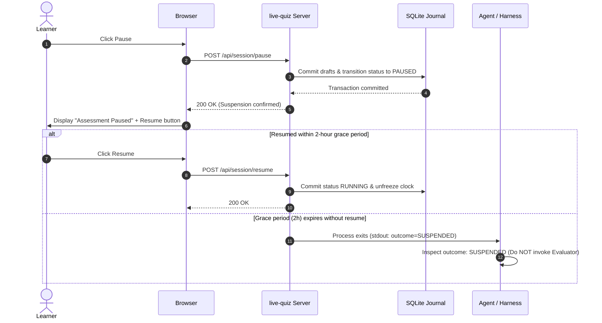

# ADR-0002: Harness-Agnostic Process Lifecycle

- Status: Accepted
- Date: 2026-11-10

## Context
When an AI agent or skill invokes `live-quiz`, the execution must not block agent reasoning indefinitely, yet the agent must be notified when the assessment concludes or suspends. We needed a process coordination mechanism that works cleanly without tight coupling to proprietary agent harnesses, while correctly distinguishing between process exit and assessment completion.

## Decision
Design `live-quiz` as a standard foreground UNIX process whose termination signals that an execution cycle has ended, but **not necessarily that the assessment has concluded**:

1. **Independent Lifecycles:**
   $$\text{Process State (Running / Exited)} \neq \text{Assessment State (RUNNING / PAUSED / COMPLETED)}$$
   A process exit indicates only that the current HTTP execution cycle has ended.
2. **Structured Lifecycle Outcome:**
   Upon process termination, `live-quiz` emits a machine-readable JSON outcome on stdout:
   - **`FINALIZED`:** The assessment reached a terminal state (`COMPLETED`, `CLOSED_EARLY`, `TIMED_OUT`). `attempt.json` was durably exported. Caller proceeds to evaluation.
   - **`SUSPENDED`:** The assessment was paused and the server deliberately exits upon 2-hour grace period expiration. The pause grace period is measured using Linux `CLOCK_BOOTTIME` (advancing across system sleep) on the current host boot, distinct from the learner's active assessment budget (`CLOCK_MONOTONIC`). The SQLite journal is retained with status `PAUSED`. Caller does **not** invoke evaluation. Unexpected termination (`SIGKILL`, power failure) cannot guarantee a structured outcome packet; the caller must detect abnormal exit and offer manual recovery.
   - **`ERROR`:** An operational error occurred. The SQLite journal is retained for recovery.
3. **Sequence Diagram:**

## Alternatives Considered
- **Treating Every Process Exit as Assessment Completion:** Rejected. Conflating process termination with assessment finalization leads to evaluating incomplete paused attempts.
- **Immediate Process Exit on Pause:** Rejected. Turning an ordinary short interruption (e.g. 2-minute phone call) into an unrecoverable dead browser tab destroys UX.
- **Antigravity Sidecars and `agentapi`:** Rejected. Coupled to internal language server environment variables.

## Consequences
- **Positive:** Complete decoupling from harness internals; standard OS process semantics (`exit 0`); portable across Antigravity, Claude Code, terminal shells, and CI pipelines.
- **Negative / Trade-offs:** Requires the calling host environment or user to manage process execution (e.g. running as a background task).

## Related Decisions
- [ADR-0001: Standalone Local Web Application](./0001-standalone-web-application.md)
- [ADR-0006: Ephemeral SQLite Session Journal & Recovery](./0006-ephemeral-sqlite-session-journal.md)
