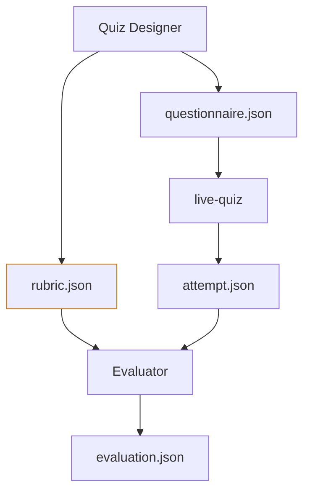

# ADR-0004: Physical Separation of Questionnaire and Rubric

- Status: Accepted
- Date: 2026-11-10

## Context
A core pedagogical invariant of the assessment model is the blind pass: the learner must demonstrate unassisted performance against an invariant standard without receiving private evaluation criteria while completing the assessment. We needed an architectural mechanism to prevent private evaluation data from entering the learner-facing runtime.

## Decision
Enforce complete physical and structural decoupling of the assessment specification at the filesystem and contract levels into two distinct artifacts:
1. `questionnaire.json`: The public presentation contract containing question IDs, markdown prompts, diagrams, options, and code stubs. Passed directly to `live-quiz`.
2. `rubric.json`: The private evaluation contract containing expected answers, observable criteria (Complete/Partial/Insufficient), failure mode diagnoses, and misconception signatures. Retained outside `live-quiz` and supplied exclusively to the post-hoc evaluator after terminal publication.

### Architectural Safeguards & Boundaries
1. **Physical Runtime Separation:**
   `questionnaire.json` is the only assessment-definition artifact accepted by `live-quiz`. No supported CLI option, configuration parameter, API, or runtime code path allows `rubric.json` or its contents to enter the engine. Private evaluation data is never transmitted to the browser or exposed in the learner-facing tutoring context before assessment conclusion.
2. **Recursive Structural Contract Separation & Pydantic Inheritance:**
   The public and private specifications are maintained as separate Pydantic models. Because Pydantic v2 does not automatically propagate `model_config = ConfigDict(extra="forbid")` across nested `BaseModel` boundaries, root-level configuration alone is insufficient. Every public-contract model at every nesting depth (including root questionnaire, question models, option objects, and input blocks) must explicitly inherit from a shared strict base model (e.g. `StrictBaseModel`) configured with `extra="forbid"` or declare `extra="forbid"` directly. Contract test suites must enforce negative validation tests asserting that unexpected evaluation properties are rejected at multiple nesting levels.
3. **Context-Isolated Post-Hoc Evaluation:**
   `quiz-evaluator` operates purely as $f(\text{rubric.json}, \text{attempt.json}) \to \text{evaluation.json}$ and receives `rubric.json` and `attempt.json` only after successful terminal publication. The evaluator receives zero conversational history, tutor notes, or learner-profile context. The Tutor subsequently uses `evaluation.json` during the debrief.
4. **Ergonomic Presentation & Explicit Non-Goals:**
   `live-quiz` retains its standard one-question-at-a-time presentation for cognitive ergonomics, but does not impose navigation locking or anti-backtracking mechanisms solely for security. Furthermore, the system explicitly rejects automated LLM-based semantic leakage detection or cross-question answer-leakage graph analysis; semantic prompt quality remains an authoring responsibility.

## Alternatives Considered
- **Single Unified Assessment JSON with Runtime Filtering:** Rejected. Passing a single file containing both questions and answer keys creates a severe risk of accidental solution leakage through permissive API routes, serialization bugs, or client-side inspection.
- **Automated Semantic Leakage Detection Pipelines:** Rejected. Introduces substantial LLM latency and coordination overhead for a personal formative assessment tool where prompt clarity is an authoring design concern.

## Consequences
- **Positive:** Physical exclusion of the private rubric artifact from the engine and structural rejection of undeclared evaluation properties in the public questionnaire; the runtime cannot expose private rubric data it never receives through browser DevTools, API inspection, or network monitoring (though this does not prevent semantically equivalent information from appearing in public questionnaire content); clean, testable separation between assessment execution and post-hoc grading.
- **Engineering Guarantee & Scope Boundary:** Physical separation guarantees that the `live-quiz` runtime does not receive or expose private evaluation data. It does not guarantee that public questionnaire content authored by an LLM or human is semantically free of answers, clues, or cross-question leakage. Host-level inspection of local files or process memory remains outside the formative assessment threat model.

## Related Decisions
- [ADR-0003: Static Code Challenges Without Runtime Execution](./0003-static-code-challenges.md)
- [ADR-0007: Atomic Versioned JSON Export Contract](./0007-atomic-json-export-contract.md)
