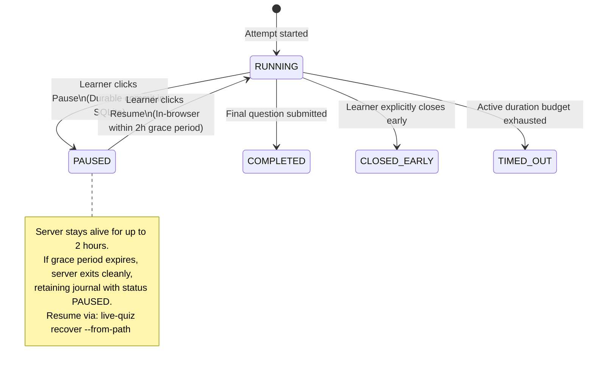

# ADR-0006: Ephemeral SQLite Session Journal & Recovery

- Status: Accepted
- Date: 2026-11-10

## Context
During an assessment, the application must withstand interruptions (unexpected process kills via `SIGKILL`, system sleep, power failure, or tab refresh) without losing acknowledged answers or unsubmitted drafts. Furthermore, learners need an explicit **Pause / Resume** control to handle real-life interruptions without keeping a local server process running for hours.

## Decision
Use a temporary, local SQLite database (`~/.local/state/live-quiz/sessions/<attempt-id>.sqlite3`) strictly as an ACID-compliant **write-ahead session journal** during active execution:
1. **Three Separated Lifecycles:**
   - *Server Process:* Ephemeral (runs on demand, exits on finalization or pause grace-period expiration).
   - *Assessment Instance:* Persistent concept identified by stable IDs and immutable questionnaire version hashes.
   - *Assessment Attempt:* Persistent run representing a single pass against an immutable assessment version.
2. **Transactional State Journaling & Durable Checkpoints:**
   - Every acknowledged answer submission, draft update, and timing event is committed immediately to SQLite.
   - Clicking **Pause** creates a durable checkpoint: pending drafts are saved, active time is frozen, and `status = PAUSED` is committed before browser acknowledgment.
   - **Configurable Pause Grace Period (Default: 2 Hours):** The local server stays running during a 2-hour window (`--pause-grace-period 2h`). Resuming within this window is instant in the browser without CLI/agent interaction.
   - If the 2-hour window expires without resumption, the server terminates cleanly to prevent zombie processes, retaining the journal with status `PAUSED`.
3. **Assessment State Machine:**

4. **Journal Destruction Invariant:**
   - Upon reaching a terminal state (`COMPLETED`, `CLOSED_EARLY`, `TIMED_OUT`), the server publishes `attempt.json`.
   - The temporary SQLite journal is deleted **only after durable export publication succeeds**.
5. **Explicit Recovery Command:**
   - If a process is killed unexpectedly (`SIGKILL`) or grace period expires while paused, the journal remains on disk.
   - Running `live-quiz recover --from-path <journal.sqlite3>` validates the journal, restores the authoritative clock, reloads drafts, and resumes the server under the exact same `attempt_id`.
   - *Recovery Idempotency:* If recovery is invoked on a journal whose `attempt.json` was already successfully published, it verifies the export, cleans up the journal, and exits cleanly.

## Alternatives Considered
- **Permanent SQLite LMS Database:** Rejected. Burdening `live-quiz` with multi-workspace relational history, cross-project analytics, and long-term migrations creates severe scope creep. `live-quiz` is an assessment execution harness, not a full Learning Management System.
- **Flat-File JSON Appending:** Rejected. Subject to partial-write corruption during sudden process kills (`SIGKILL`) or power failures.

## Consequences
- **Positive:** Guarantees zero data loss for acknowledged submissions and drafts under crashes; allows pausing without running background processes; leaves zero state accumulation upon clean completion.
- **Negative / Trade-offs:** Requires an explicit recovery command (`live-quiz recover`) and managing temporary journal files in the XDG state directory.

## Related Decisions
- [ADR-0002: Harness-Agnostic Process Lifecycle](./0002-harness-agnostic-process-lifecycle.md)
- [ADR-0007: Atomic Versioned JSON Export Contract](./0007-atomic-json-export-contract.md)
