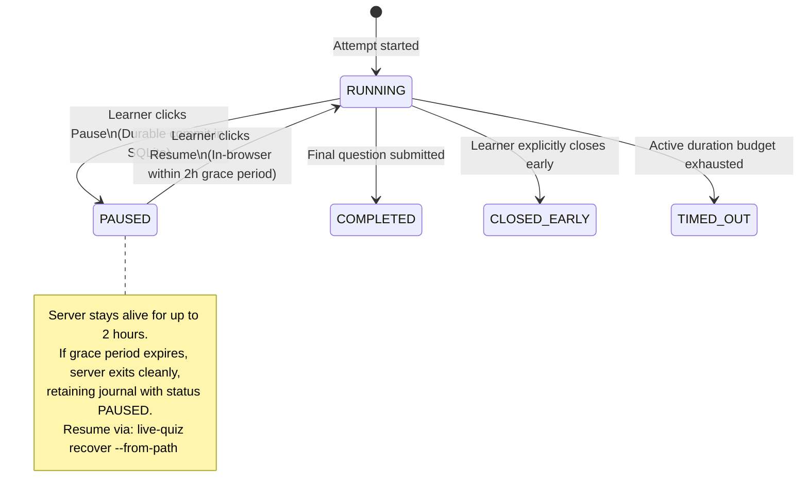

# ADR-0006: Ephemeral SQLite Session Journal & Recovery

- Status: Accepted
- Date: 2026-11-10

## Context
During an assessment, the application must withstand interruptions (unexpected process kills via `SIGKILL`, system sleep, power failure, or tab refresh) without losing acknowledged answers or unsubmitted drafts. Furthermore, learners need an explicit **Pause / Resume** control to handle real-life interruptions without keeping a local server process running for hours.

## Decision
Use a temporary, local SQLite database (`~/.local/state/live-quiz/sessions/<attempt-id>.sqlite3`) strictly as an ACID-compliant **write-ahead session journal** during active execution:
1. **Three Separated Lifecycles:**
   - *Server Process:* Ephemeral (runs on demand, exits on finalization or pause grace-period expiration).
   - *Assessment Instance:* Persistent concept identified by stable IDs and immutable questionnaire version hashes.
   - *Assessment Attempt:* Persistent run representing a single pass against an immutable assessment version.
2. **Transactional State Journaling & Durable Checkpoints:**
   - Every acknowledged answer submission, draft update, and timing event is committed immediately to SQLite.
   - Clicking **Pause** creates a durable checkpoint: pending drafts are saved, active time is frozen, and `status = PAUSED` is committed before browser acknowledgment.
   - **Configurable Pause Grace Period (Default: 2 Hours):** The local server stays running during a 2-hour window (`--pause-grace-period 2h`). Resuming within this window is instant in the browser without CLI/agent interaction.
   - If the 2-hour window expires without resumption, the server terminates cleanly to prevent zombie processes, retaining the journal with status `PAUSED`.
3. **Assessment State Machine:**

4. **Durability Invariants & Engine Pragmas:**
   - **Commit-Before-Ack:** The HTTP server commits transactions to SQLite *before* returning a successful `200 OK` acknowledgement to the client for any submission or autosaved draft.
   - **Engine Configuration:** SQLite runs in Write-Ahead Logging mode (`PRAGMA journal_mode=WAL; PRAGMA synchronous=FULL;`). `synchronous=FULL` ensures SQLite performs the required WAL synchronization after each transaction commit, providing durability against process and system failures under the documented filesystem and storage assumptions.
   - **Storage Location & Journal File Set:** Journals reside on persistent local storage (`~/.local/state/live-quiz/sessions/`), never in volatile tmpfs. In WAL mode, the journal consists of the primary database (`<attempt-id>.sqlite3`) and its companion files (`<attempt-id>.sqlite3-wal`, `<attempt-id>.sqlite3-shm`). Because committed transactions may reside in the `-wal` file before checkpointing, recovery and lifecycle operations must manage and preserve the entire journal file set.
   - **Crash Recovery Scope:** Recovery guarantees restoration of all *acknowledged* state. Unacknowledged in-flight client keystrokes that never completed an HTTP transaction are explicitly excluded.
   - **Active-Time Recovery:** Active time is measured via a monotonic clock and checkpointed periodically (~1s interval). On recovery after an unexpected crash, the active countdown resumes from the last committed checkpoint. Process downtime while dead is excluded from the active-time budget and recorded separately as an interruption event.
5. **Journal Destruction Invariant & Draft Preservation:**
   - Upon reaching a terminal state (`COMPLETED`, `CLOSED_EARLY`, `TIMED_OUT`), the server serializes `attempt.json`, preserving all submitted responses, acknowledged unsubmitted drafts (as `DRAFT`), and unattempted questions (as `UNANSWERED`).
   - The temporary SQLite journal file set (`.sqlite3`, `-wal`, `-shm`) is unlinked **only after durable export publication succeeds** and all database connections are closed. If publication fails, the journal remains intact for retry via recovery.
6. **Explicit Recovery Command & Two Recovery Paths:**
   - If a process is killed unexpectedly (`SIGKILL`) or grace period expires while paused, the journal set remains on disk.
   - Running `live-quiz recover --from-path <journal.sqlite3>` inspects journal state and executes one of two deterministic paths:
     1. **Nonterminal Recovery:** For `RUNNING` or `PAUSED` attempts, validates the journal set (leveraging companion `-wal`), restores the authoritative clock, reloads drafts, and resumes the server under the exact same `attempt_id`.
     2. **Terminal Export Recovery:** If the journal already records a terminal state (`COMPLETED`, `CLOSED_EARLY`, `TIMED_OUT`) but publication failed, recovery retries `attempt.json` publication directly from the journal without reopening the assessment session, restarting the timer, or permitting further modifications.
   - *Recovery Idempotency:* If recovery is invoked on a journal whose `attempt.json` was already successfully published, it verifies the export, cleans up the journal file set, and exits cleanly.

## Alternatives Considered
- **Permanent SQLite LMS Database:** Rejected. Burdening `live-quiz` with multi-workspace relational history, cross-project analytics, and long-term migrations creates severe scope creep. `live-quiz` is an assessment execution harness, not a full Learning Management System.
- **Flat-File JSON Appending:** Rejected. Subject to partial-write corruption during sudden process kills (`SIGKILL`) or power failures.

## Consequences
- **Positive:** Guarantees reliable recovery of all acknowledged submissions and drafts across process termination (`SIGKILL`, application crash) under documented WAL mode assumptions; prevents active-time budget leakage during crash downtime; allows in-browser pause without indefinite background processes; leaves zero state accumulation upon clean completion.
- **Negative / Trade-offs:** Requires an explicit recovery command (`live-quiz recover`) and managing temporary journal files (`.sqlite3`, `-wal`, `-shm`) in the XDG state directory; does not protect against unacknowledged client-side keystrokes that never completed an HTTP transaction.

## Related Decisions
- [ADR-0002: Harness-Agnostic Process Lifecycle](./0002-harness-agnostic-process-lifecycle.md)
- [ADR-0007: Atomic Versioned JSON Export Contract](./0007-atomic-json-export-contract.md)
