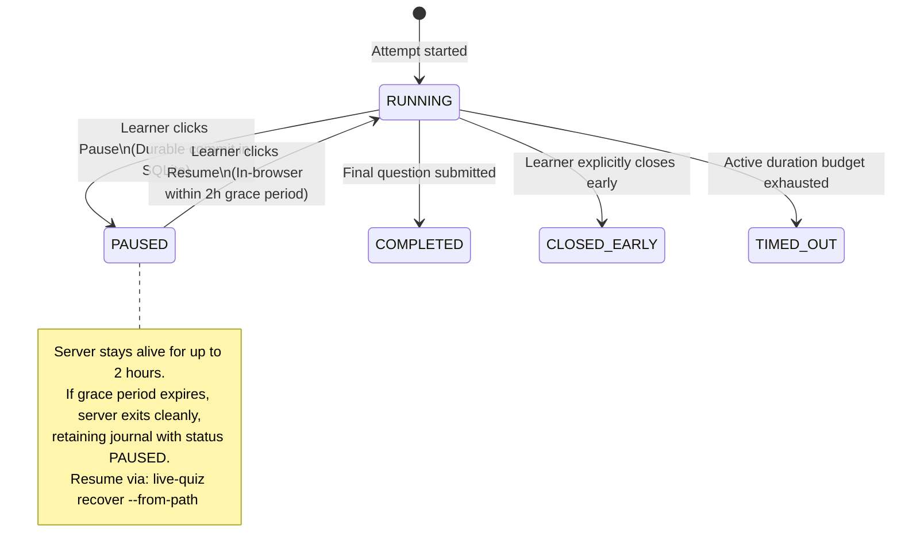

# ADR-0006: Ephemeral SQLite Session Journal & Recovery

- Status: Accepted
- Date: 2026-11-10

## Context
During an assessment, the application must withstand interruptions (unexpected process kills via `SIGKILL`, system sleep, power failure, or tab refresh) without losing acknowledged answers or unsubmitted drafts. Furthermore, learners need an explicit **Pause / Resume** control to handle real-life interruptions without keeping a local server process running for hours.

## Decision
Use a temporary, local SQLite database (`~/.local/state/live-quiz/sessions/<attempt-id>.sqlite3`) strictly as an ACID-compliant **write-ahead session journal** during active execution:
1. **Three Separated Lifecycles:**
   - *Server Process:* Ephemeral (runs on demand, exits on finalization or pause grace-period expiration).
   - *Assessment Instance:* Persistent concept identified by stable IDs and immutable questionnaire version hashes.
   - *Assessment Attempt:* Persistent run representing a single pass against an immutable assessment version.
2. **Transactional State Journaling, Monotonic Time & Durable Checkpoints:**
   - Every acknowledged answer submission, draft update, and timing event is committed immediately to SQLite.
   - **Active-Time & Duration Limit Representation:** Accumulated active time is tracked and persisted as an integer nanosecond scalar (`accumulated_active_ns`) alongside the immutable assessment budget (`time_limit_ns`) in the session state table. Nanoseconds are converted to seconds only for UI display and `attempt.json` export. `time_limit_ns` is established at attempt initialization from the frozen questionnaire version; recovery must never allow changed CLI options or configuration defaults to alter an active attempt's time limit.
   - **In-Memory Anchor Advancement Invariant:**
     $$\Delta t = t_{\text{monotonic now}} - t_{\text{last committed}}$$
     $$\text{accumulated\_active\_ns}' = \text{accumulated\_active\_ns} + \Delta t$$
     The in-memory anchor `last_committed_checkpoint_ns` advances strictly **after** the SQLite transaction commits successfully. If commit fails, the anchor does not advance.
   - **Checkpoint Triggers:**
     - Periodic target: approximately 1 second while `RUNNING`.
     - Synchronous immediate accounting on: pause, autosave, submission, timeout, and early close. All timing updates share the serialized SQLite write boundary (`BEGIN IMMEDIATE`).
   - **Durable Pause Checkpoint & In-Browser Resume:** Clicking **Pause** commits pending drafts, freezes active time, records `status = PAUSED` in SQLite, and displays an in-browser Resume control.
   - **Configurable Pause Grace Period (Default: 2 Hours):** The local server stays running during a 2-hour window (`--pause-grace-period 2h`). Resuming within this window is instant in the browser without CLI/agent interaction.
   - **Boot Identity, Grace Deadline & Post-Wake Evaluation:** Pause grace is measured using Linux `CLOCK_BOOTTIME` (which advances during system sleep). When pausing, the journal persists:
     ```json
     {
       "boot_id": "...",
       "pause_started_boottime_ns": 123456789,
       "pause_deadline_boottime_ns": 123456789
     }
     ```
     Because `asyncio` delayed callbacks wrap `CLOCK_MONOTONIC` and halt during system sleep, the pause-grace watchdog re-evaluates the persisted `CLOCK_BOOTTIME` deadline at the first post-wake watchdog execution (e.g. when a suspend gap is detected or via a bounded periodic check). If the deadline passed while asleep, it triggers clean shutdown with outcome `SUSPENDED`. Across a machine reboot, the original server process is dead, in-browser resume is unavailable, and the persisted boottime deadline is never compared against a differing boot ID; the journal remains intact for manual CLI recovery.
   - If the 2-hour grace window expires without resumption, the server terminates cleanly with outcome `SUSPENDED`, retaining the journal with status `PAUSED`.
   - **Audit Trail (`session_intervals`):** An append-only table records lifecycle intervals with a strictly monotonic sequence:
     ```sql
     CREATE TABLE session_intervals (
         event_sequence INTEGER PRIMARY KEY AUTOINCREMENT,
         event_type TEXT NOT NULL, -- 'STARTED', 'PAUSED', 'RESUMED', 'SUSPEND_GAP_DETECTED', 'CRASH_RECOVERED'
         wall_timestamp_utc TEXT NOT NULL,
         accumulated_active_ns INTEGER NOT NULL
     );
     ```
     `event_sequence` guarantees interval ordering independent of NTP wall-clock slewing or discontinuous steps.
   - **Suspend Gap Detection:** By periodically comparing clock deltas ($T_{\text{suspended}} \approx \Delta T_{\text{BOOTTIME}} - \Delta T_{\text{MONOTONIC}}$), the engine detects when the host was asleep without requiring D-Bus or `systemd-logind` hooks, logging a `SUSPEND_GAP_DETECTED` event upon wake while active time remains frozen.
3. **Assessment State Machine:**



4. **Durability Invariants, Journal Schema Versioning & Dual Advisory Locking:**
   - **Commit-Before-Ack:** The HTTP server commits transactions to SQLite *before* returning a successful `200 OK` acknowledgement to the client for any submission or autosaved draft.
   - **Engine Configuration:** SQLite runs in Write-Ahead Logging mode (`PRAGMA journal_mode=WAL; PRAGMA synchronous=FULL;`). `synchronous=FULL` ensures SQLite performs the required WAL synchronization after each transaction commit under documented filesystem/storage assumptions.
   - **Independent Journal Schema Versioning:** SQLite journals declare an internal schema version (`schema_version`), evolved independently from external `attempt.json` schemas. Historical nonterminal journals are migrated directly to the current internal version via version-dispatched adapters (V1→Vcurrent).
   - **Storage Location & Journal File Set:** Journals reside on persistent local storage (`~/.local/state/live-quiz/sessions/`), never in volatile tmpfs. The journal file set consists of `<attempt-id>.sqlite3`, `<attempt-id>.sqlite3-wal`, and `<attempt-id>.sqlite3-shm`.
   - **Dual Advisory Lock Scope:** All publication and recovery operations synchronize using exclusive advisory lock files in `~/.local/state/live-quiz/locks/` (per-attempt lock `attempt-<attempt-id>.lock` and destination lock `dest-<sha256_dest>.lock`), which are never unlinked while held.
   - **Crash Recovery Scope & Timing Guarantees:** Recovery guarantees restoration of all *acknowledged* state. Active time resumes from the last successfully committed active-time checkpoint (`accumulated_active_ns`); uncommitted elapsed time is not guaranteed to be preserved under sudden termination, as the ~1-second interval is an operational target subject to system load. Process downtime while dead is excluded from the active budget and starts a fresh monotonic segment.
   - **Overdue Recovery Guard:** If nonterminal recovery (`live-quiz recover`) inspects a journal where `accumulated_active_ns >= time_limit_ns`, the engine immediately terminalizes the attempt as `TIMED_OUT` and initiates atomic export before any interactive resume is permitted.
   - **Clock Nuances & Platform Baseline:** Evaluated against Linux `CLOCK_MONOTONIC`. Immune to discontinuous wall-clock adjustments (manual time changes, NTP steps), though subject to NTP frequency slewing. Halts during system suspend.
5. **Atomic Terminal Commitment & Safe Ordered Destruction:**
   - **Atomic Terminal Transaction & Path Distinction:** The SQLite write boundary is established before final snapshot extraction via `BEGIN IMMEDIATE`:
     - *Path A (Final Submission → `COMPLETED`):* The response mutation to `SUBMITTED`, transition to `COMPLETED`, complete response snapshot, and `publication_intent` (`target_schema_version`, `export_projection_version: "1"`, `canonicalization_version: "1"`, `destination_path`, `expected_sha256`) are committed in one single atomic transaction. The final response is never acknowledged without atomically committing completion.
     - *Path B (Timeout / Early Close):* The transaction lock is established before extracting the snapshot (capturing current drafts and unanswered questions) and committing `TIMED_OUT` or `CLOSED_EARLY` alongside `publication_intent`.
   - **Safe Ordered Deletion:** The journal is destroyed only after publication durability (including directory `fsync`) is established: through an open writable connection execute verified WAL checkpoint (`PRAGMA wal_checkpoint(TRUNCATE);`) → close all database connections cleanly → verify companion removal (unlinking `-wal` and `-shm` explicitly if present) → unlink primary `.sqlite3` **last**.
   - If cleanup fails after durable export, `live-quiz` exits with `CLEANUP_PENDING` (code 6), preserving `.sqlite3` for cleanup retry.
6. **Recovery Paths & Hash-Verified Idempotency:**
   - **Nonterminal Recovery:** In-place transactional migration to current internal schema; live assessment resumed.
   - **Terminal Export Recovery:** Decouples Phase 1 read-only extraction from Phase 2 post-verification writable cleanup:
     - *Phase 1 (Read-Only):* Uses read-only connection (`mode=ro`) to read existing WAL frames without mutating database tables or schema; reconstructs export using `export_projection_version` and verifies against persisted `expected_sha256`. Legacy journals lacking `publication_intent` are rejected as unsupported (`UNSUPPORTED_SCHEMA_VERSION`, exit 5). Phase 1 read-only connection is closed cleanly before Phase 2.
     - *Idempotency Verification:* Compares existing destination artifacts against persisted `expected_sha256`. Matching hash triggers Phase 2 cleanup; mismatch triggers an integrity conflict (exit 3); different `attempt_id` triggers artifact conflict (exit 2).
     - *Phase 2 (Writable Cleanup):* Opened only after Phase 1 connection is closed and durable publication is established; executes verified WAL checkpoint without schema or table modifications, closes connection, and unlinks companions then `.sqlite3` last.
   - **Orphan Anomaly Rule:** Orphaned `-wal` or `-shm` files without `.sqlite3` represent an unexpected anomaly; recovery halts safely and reports an integrity error without deleting files.

## Alternatives Considered
- **Permanent SQLite LMS Database:** Rejected. Burdening `live-quiz` with multi-workspace relational history, cross-project analytics, and long-term migrations creates severe scope creep. `live-quiz` is an assessment execution harness, not a full Learning Management System.
- **Flat-File JSON Appending:** Rejected. Subject to partial-write corruption during sudden process kills (`SIGKILL`) or power failures.

## Consequences
- **Positive:** Guarantees reliable recovery of all acknowledged submissions and drafts across process termination (`SIGKILL`, application crash) under documented WAL mode assumptions; provides server-authoritative timing relative to the browser; prevents active-time budget leakage during crash downtime or host system suspension; allows in-browser pause without indefinite background processes; leaves zero state accumulation upon clean completion.
- **Negative / Trade-offs:** Requires an explicit recovery command (`live-quiz recover`) and managing temporary journal files (`.sqlite3`, `-wal`, `-shm`) in the XDG state directory; does not protect against unacknowledged client-side keystrokes that never completed an HTTP transaction; relies on Linux-specific clock interfaces (`CLOCK_BOOTTIME`). Host root/user manipulation is outside the formative assessment threat model.

## Related Decisions
- [ADR-0002: Harness-Agnostic Process Lifecycle](./0002-harness-agnostic-process-lifecycle.md)
- [ADR-0007: Atomic Versioned JSON Export Contract](./0007-atomic-json-export-contract.md)
